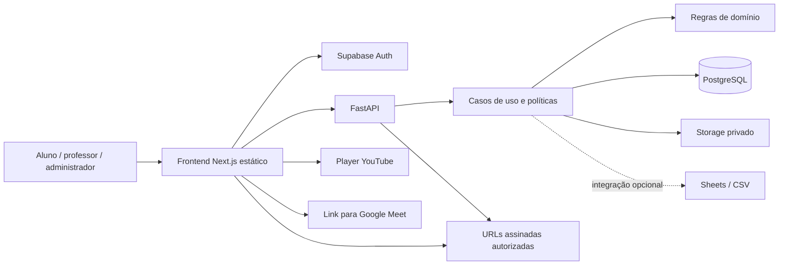
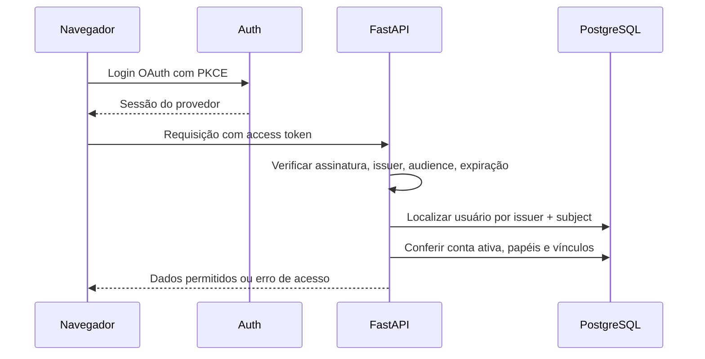
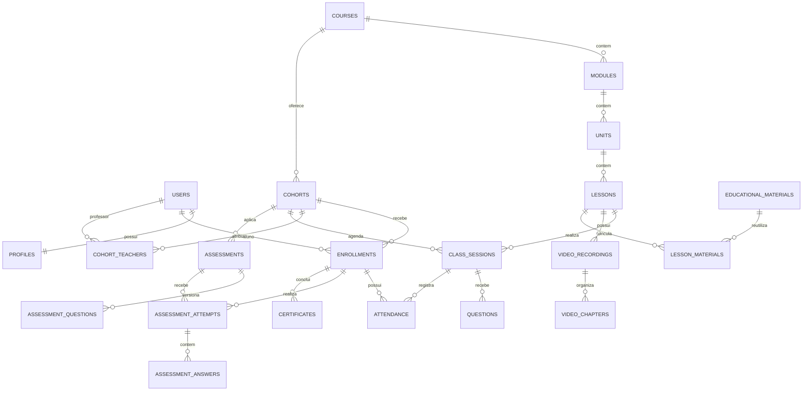

# 0003 — Arquitetura e modelo de dados

Data: 09/11/2026. Estado: especificação para implementação. Orientações aprovadas pelo usuário no registro 0001; condições de hospedagem no registro 0002. Diagramas representam o sistema proposto, não serviços já existentes.

## Decisões arquiteturais

1. Monólito modular FastAPI; uma implantação de API e um banco relacional.
2. Camadas dentro dos módulos: API, aplicação, domínio e infraestrutura. Domínio não importa FastAPI ou serviços externos.
3. Frontend Next.js/TypeScript com Tailwind, inicialmente estático e sem regras acadêmicas duplicadas.
4. Pydantic para contratos e configurações; SQLAlchemy 2 para persistência e Alembic para migrações.
5. Regras de aprovação e acesso em Python; constraints no banco. Procedures somente com justificativa e testes.
6. Supabase PostgreSQL/Auth/Storage como candidato inicial integrado; adaptadores evitam acoplar regras acadêmicas aos SDKs.
7. Sessão SQLAlchemy por requisição/unidade de trabalho, com transações nos casos de uso. Começar com driver síncrono psycopg e handlers compatíveis, sem I/O bloqueante em `async def`. Async não será adotado apenas por preferência estética; reavaliar por medição. Não compartilhar sessão entre tarefas concorrentes.
8. Nenhum Redis, Celery, microserviço, barramento ou colaboração simultânea de lousa na fundação.
9. Identificadores UUID; datas persistidas em UTC (`timestamptz`); exibição no fuso da escola, inicialmente America/Sao_Paulo. Durações e timestamps de vídeo em segundos inteiros não negativos.
10. Histórico documental imutável por adição em `.documentacao`; documentos de navegação em `docs` apontam para os registros datados.

Referências técnicas: [FastAPI deployment](https://fastapi.tiangolo.com/deployment/concepts/), [SQLAlchemy Session](https://docs.sqlalchemy.org/en/20/orm/session_basics.html) e [Supabase conexão PostgreSQL](https://supabase.com/docs/guides/database/connecting-to-postgres). A escolha de modo de pooler, IPv4/IPv6 e limites de conexão precisa ser testada no ambiente de publicação.

## Componentes



O acesso direto do navegador ao Auth é permitido para autenticação. O acesso aos dados acadêmicos passa pela API; URLs assinadas permitem download direto e temporário de objetos após autorização. A API não retransmite todos os bytes dos vídeos ou PDFs.

## Estrutura proposta

```text
backend/
  app/
    main.py
    core/              # configuração, erros, segurança, conexão, observabilidade
    modules/
      identity/
      academic/
      library/
      interactions/
      attendance/
      assessments/
      certificates/
      whiteboards/
      integrations/
    # Cada módulo pode conter api/, application/, domain/, infrastructure/
  migrations/
  tests/
    unit/
    integration/
    authorization/
frontend/
  src/app/
  src/components/
  src/features/
  src/lib/
  tests/
infra/
docs/
.documentacao/
```

Criar pastas apenas quando houver conteúdo. Não gerar quatro arquivos vazios por entidade ou repositório CRUD genérico. Repositórios representam agregados/consultas que ajudam os casos de uso; transação é coordenada pela aplicação, não por commits independentes de cada repositório.

## Identidade e autenticação

Recomendação: Supabase Auth com Google OAuth como primeiro caminho sem dependência do SMTP padrão; e-mail/senha somente quando SMTP próprio e recuperação estiverem configurados e testados. OAuth exige projeto, credenciais e redirecionamentos autorizados. Não há autenticação pública configurada hoje.

Fluxo:



Verificar tokens com biblioteca mantida e chaves do emissor, cache limitado e tratamento de rotação. Nunca confiar no `role` enviado pelo cliente. Bloqueio de conta acadêmica deve surtir efeito na API independentemente da validade residual do token externo.

Para frontend estático, sessão gerida pelo SDK no navegador exige controle contra XSS. Estratégia inicial proposta: persistência de sessão desativada, sessão em memória e novo login após recarregar; confirmar impacto de UX no primeiro fluxo. Não anunciar cookies HttpOnly fornecidos por um servidor Next que não existe. Persistência entre recargas ou mudança para sessão backend por cookie deverá ter decisão específica com proteção CSRF, CORS e topologia de domínios verificadas. Não gravar tokens em logs nem históricos.

Primeiro administrador: provisionamento administrativo explícito, sem promover automaticamente o primeiro cadastro. Login bem-sucedido não concede matrícula. Papéis locais são atribuídos por administrador autorizado e auditados.

## Permissões

| Recurso/operação | Visitante | Aluno | Professor | Administrador |
|---|---|---|---|---|
| Catálogo e informações públicas | Ler publicados | Ler publicados | Ler publicados | Gerenciar |
| Aula restrita/material | Não | Matrícula ativa e conteúdo liberado | Turma atribuída | Sim |
| Criar/publicar curso | Não | Não | Apenas se delegado explicitamente | Sim |
| Criar sessão/moderar | Não | Não | Turma atribuída | Sim |
| Pergunta/comentário/voto | Não | Própria ação na turma autorizada | Turma atribuída | Sim |
| Matrícula e turma | Não | Consultar própria; solicitar matrícula | Consultar alunos da sua turma | Gerenciar |
| Resposta de avaliação | Não | Própria tentativa no prazo | Corrigir sua turma | Sim |
| Notas/frequência | Não | Próprias | Sua turma | Sim |
| Emitir/revogar certificado | Não | Solicitar/baixar próprio se elegível | Consultar e recomendar, sem emissão por padrão | Sim |
| Validar certificado público | Estado mínimo por código | Igual | Igual | Igual |
| Configurar integrações/papéis | Não | Não | Não, salvo integração explicitamente delegada | Sim |

Verificar autorização em listagem, detalhe, alteração, exportação e emissão de URL assinada. Filtrar por escopo no SQL e testar IDs de outros usuários; esconder botões não é controle de acesso. Recurso inexistente ou invisível deve evitar revelar sua existência desnecessariamente.

Schema acadêmico privado, fora dos schemas expostos pela Data API. Revogar permissões de `anon`/`authenticated` sobre dados acadêmicos; runtime SQL próprio com menor privilégio, sem usar usuário postgres ou chave service-role para consultas comuns. RLS é defesa adicional para tabelas sensíveis: se adotada, propagar identidade com `SET LOCAL` em transação e testar isolamento no pool. Não assumir que RLS funciona com usuário que a ignora. Papel de migração separado; service-role de Storage, se necessária, só no servidor e com autorização anterior.

## Modelo relacional

### Identidade

- `users`: UUID local, `auth_issuer`, `auth_subject`, e-mail, situação, criação; unique(issuer, subject).
- `profiles`: user_id único, nome de exibição e nome de certificação; coleta mínima.
- `roles`, `user_roles`: papéis globais; alterações auditadas.

### Currículo e oferta

- `courses`: título, slug, descrição, estado rascunho/publicado/arquivado.
- `modules`: course_id, título, ordem.
- `units`: module_id, título, ordem.
- `lessons`: unit_id, objetivos, descrição, ordem e estado editorial.
- `cohorts`: course_id, nome da turma, período, situação e configuração de aprovação.
- `cohort_teachers`: cohort_id + teacher_id únicos; vínculo de responsabilidade.
- `enrollments`: cohort_id + student_id únicos, situação solicitada/ativa/cancelada/concluída, matrícula e datas.
- `class_sessions`: cohort_id, lesson_id, professor, início/fim previsto, situação e peso/carga horária. Garantir que aula e turma pertençam ao mesmo curso.
- `live_sessions`: class_session_id, provedor, video_id ou URL validada, visibilidade e instruções. Sem token embutido no link.
- `video_recordings`: lesson_id, class_session_id opcional, provider_video_id, título, estado e disponibilidade. Escopo de acesso explícito por turma ou curso.
- `video_chapters`: recording_id, título, posição e start_seconds >= 0; unique(recording_id, start_seconds).
- `lesson_completions`: enrollment_id + lesson_id únicos, estado e data; progresso separado de presença.
- `announcements`: turma/curso, autor, texto e publicação.

### Biblioteca e lousa

- `educational_materials`: título, tipo, resumo, visibilidade, licença, object_key ou URL externa, tamanho, hash e autor do cadastro.
- `material_authors`, `material_author_links`, `library_categories`, `material_categories`, `tags`, `material_tags`.
- `lesson_materials` e `course_materials`: vínculos reutilizáveis; evitar uma FK polimórfica sem integridade.
- `material_favorites`: user_id + material_id únicos; `material_access_events` com retenção limitada.
- `whiteboards`: lesson_id, owner_id, revisão, object_key do JSON e imagem exportada. Controle otimista de versão para evitar perda de edição; colaboração simultânea fora do MVP.

### Interação e presença

- `questions`: class_session_id, author_id, texto, status, timestamps e moderador; fila com ordenação estável.
- `polls`, `poll_options`, `poll_votes`: enquete por sessão, janela de voto, opção; unique(poll_id, user_id); opção deve pertencer à enquete.
- `discussions`, `discussion_posts`: discussão por curso/turma/aula e respostas com moderação.
- `lesson_comments`: lesson_id, autor, parent_id opcional, situação; pai deve pertencer à mesma aula.
- `participation_events`: matrícula/sessão, tipo de atividade e horário; coleta somente necessária.
- `attendance`: enrollment_id + class_session_id únicos, estado pendente/presente/ausente/justificado, método, decisão do professor e justificativa.
- `attendance_events`: evidências append-only de check-in e ajustes, com ator e horário.

### Avaliações e certificados

- `question_bank_items`, `question_options`: questões reutilizáveis e alternativas; gabarito restrito.
- `assessments`: turma/módulo, janela, duração, limite de tentativas, nota mínima, política de liberação e versão.
- `assessment_questions`: snapshot da questão e peso na versão publicada; alterações posteriores não mudam tentativas existentes.
- `assessment_attempts`: assessment_id, enrollment_id, número, estado, início, prazo calculado no servidor e envio; unique(assessment_id, enrollment_id, number).
- `assessment_answers`: attempt_id + assessment_question_id únicos, alternativa/texto e correção.
- `grades`: resultado por matrícula/avaliação, nota, versão e publicação; trilha de alterações em auditoria.
- `assignments`, `assignment_submissions`: atividade e entrega versionada, se distinta de prova; não duplicar fluxo de avaliação sem necessidade.
- `completion_policies`: critérios versionados de nota, frequência e carga horária; turma aponta para versão vigente aplicável.
- `certificates`: enrollment_id, policy_version_id, código aleatório único, snapshot de nome/curso/carga/nota conforme necessidade interna, data, estado, motivo de revogação e object_key do PDF.
- `certificate_verifications`: eventos mínimos, sem acumular IPs brutos ou dados pessoais sem finalidade definida.
- `audit_logs`: ator, operação, recurso, momento e mudanças permitidas; excluir tokens, senhas e gabaritos completos dos logs.
- `integration_settings`: identificadores e configuração não secreta; referência externa ao segredo ou conteúdo criptografado com chave fora do banco.
- `import_runs`, `import_rows`: prévia, estado, origem, chave externa, resultado e erros; importação repetida não duplica matrícula.

### Relações principais



Diagrama resumido; catálogo acima inclui relações auxiliares. Modelo lógico ainda não é migração SQL executada.

## Constraints, índices e concorrência

- Índices em FKs usadas em filtros/joins; PostgreSQL não cria automaticamente todos os índices nas colunas que referenciam FKs.
- Índices compostos prováveis: `enrollments(student_id, status)`, `class_sessions(cohort_id, starts_at)`, `questions(class_session_id, status, created_at, id)` e `assessment_attempts(enrollment_id, assessment_id)`.
- Unique para voto, matrícula, presença, conclusão por aula e código de certificado; índices criados por unique não devem ser duplicados.
- Checks para pesos positivos, percentuais válidos, datas coerentes e timestamps não negativos. Regras entre tabelas são validadas no caso de uso e por desenho de FKs compostas quando necessário.
- Contagem de tentativas, envio e emissão de certificado precisam de transação e controle concorrente; não basta consultar e depois inserir sem proteção.
- Não excluir em cascata histórico acadêmico publicado. Arquivamento e anonimização dependem de retenção definida; exclusão lógica não substitui atendimento à exclusão de dados.
- Índices novos devem ser avaliados com consultas representativas e EXPLAIN; não indexar toda coluna.

## Fluxos acadêmicos

### Criação de aula

Professor autenticado → verificar atribuição à turma → selecionar aula curricular → criar sessão e link validado → salvar rascunho → publicar → registrar auditoria. Aluno vê somente sessão publicada de turma autorizada. Alteração de agenda não modifica presença passada silenciosamente.

### Participação do aluno

Login → matrícula ativa → sessão liberada → player ou link externo → pergunta própria persistida → moderação → check-in dentro da janela → evidência pendente de critérios/professor → registro acadêmico. Abrir player ou completar vídeo não marca presença automaticamente.

### Avaliação

Professor publica versão → aluno inicia com horário/prazo do servidor → reserva tentativa em transação → respostas salvas dentro da janela → envio idempotente → correção objetiva no servidor → discursiva aguarda professor → resultado publicado conforme política. Tempo é imposto pelo servidor mesmo após recarregar a página. Endpoint de aluno não retorna gabarito prematuro.

### Certificado

Administrador solicita emissão → bloquear/serializar matrícula → calcular critérios da versão aplicável → persistir snapshot e código imprevisível com estado de geração → gerar PDF determinístico por dados registrados → upload → marcar emitido. Falha mantém estado recuperável, sem simular sucesso e sem duplicar certificado. Reemissão segue política explícita; revogação preserva registro.

QR aponta para página pública que consulta API por código. Resposta mínima: válido/revogado/inexistente e curso/data quando apropriado; nome abreviado ou nome completo somente conforme política definida pelo responsável. Não publicar CPF, e-mail, notas ou frequência. Certificado é de curso livre; não declarar reconhecimento oficial sem base institucional.

## Segurança e operação

- CORS por origens exatas, TLS, CSP compatível com player e sem scripts arbitrários, validação de conteúdo, paginação e limites de payload.
- Sanitizar conteúdo rico ou começar com texto/Markdown restrito. Não renderizar HTML de usuário sem tratamento.
- URLs externas com HTTPS e hosts permitidos; não buscar URLs arbitrárias no backend, evitando SSRF.
- Upload privado em duas etapas: autorização, objeto temporário, verificação de tamanho/tipo e finalização; varredura e limites serão avaliados conforme formato. Downloads com disposição segura para arquivos ativos.
- Segredos no ambiente, `.env` ignorado; `.env.example` apenas com nomes e placeholders quando a fundação existir.
- Logs estruturados com correlation ID, sem conteúdo sensível; healthcheck de processo separado da prontidão do banco.
- Limites persistidos para operações críticas; limitador em memória não deve ser anunciado como global em múltiplas instâncias.
- Backups de banco e objetos, credenciais de cópia limitadas, cópia criptografada fora do ambiente primário e teste de restore.
- Jobs críticos não dependem de BackgroundTasks em instância que pode reiniciar. No MVP, operações curtas idempotentes com estado persistido e repetição explícita; worker durável quando necessário.

## Direção visual recebida

O usuário enviou imagem de inspiração durante esta etapa e pediu continuidade. Referência recebida em arquivo temporário `codex-clipboard-dd6b8541-8c7e-4ad1-bc91-6771276910f5.png`; a imagem está no chat e sua persistência no diretório temporário não é garantida.

Elementos aproveitáveis: fundo marfim, azul-marinho, dourado discreto, títulos editoriais com serifas, textos legíveis, cards claros, ícones lineares, cabeçalho institucional, navegação lateral no ambiente autenticado e destaque para próxima aula, progresso, materiais, atividades e agenda.

Adaptações necessárias:

- Separar home institucional de dashboards por papel; a referência mistura visão administrativa e acadêmica.
- Usar dados reais da API, estados vazios e carregamento; números 128, 72%, 32 e datas da imagem não são requisitos nem dados reais.
- Manter Teologando Fácil/Escola Digital de Teologia como identificação provisória do escopo. “Instituto Teológico Kairós”, professor, retrato, logotipo e demais ativos da referência não foram confirmados como identidade oficial ou arquivos licenciados para reutilização.
- Hero mais compacto dentro da área autenticada para priorizar estudo; visual mais amplo na home pública.
- Mobile com navegação recolhível e cards empilhados; testes de teclado, foco visível, contraste e zoom. Dourado não será usado em texto pequeno sem contraste adequado.
- Botões como apresentação, busca e notificações somente se tiverem fluxo funcional; não criar ações decorativas sem implementação.
- Sem geração ou download de novos ativos nesta fase de documentação.

## Questões em aberto para implantação

Identidade e ativos oficiais; elegibilidade dos serviços nas contas; canal de Auth para alunos sem Google; política de matrícula aberta versus aprovação administrativa (padrão proposto: solicitação seguida de aprovação); política de frequência, nota e carga horária; responsável por privacidade e backups. Defaults técnicos podem ser configuráveis, mas nenhum critério acadêmico deve virar fato institucional sem confirmação.
